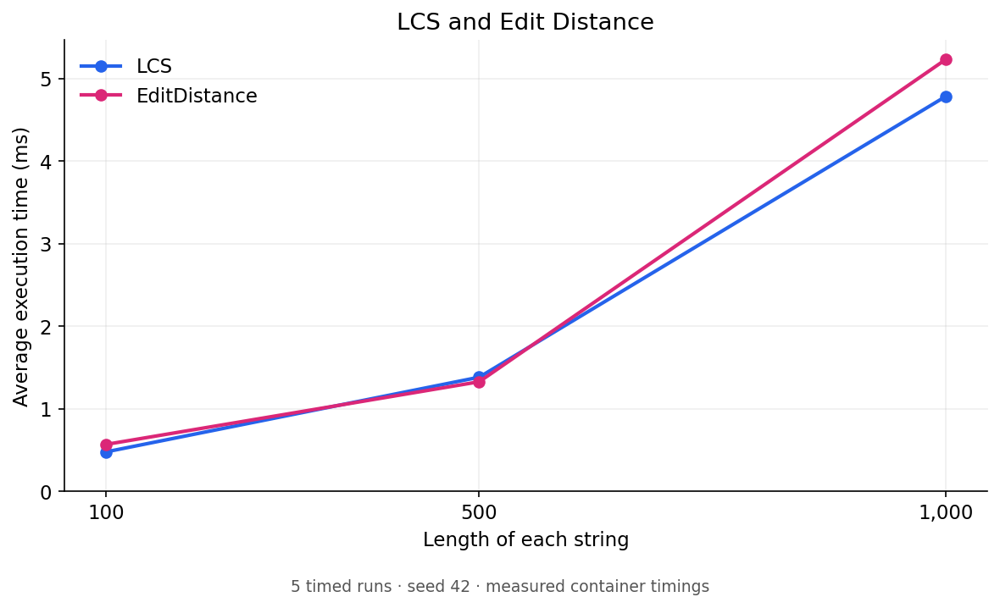
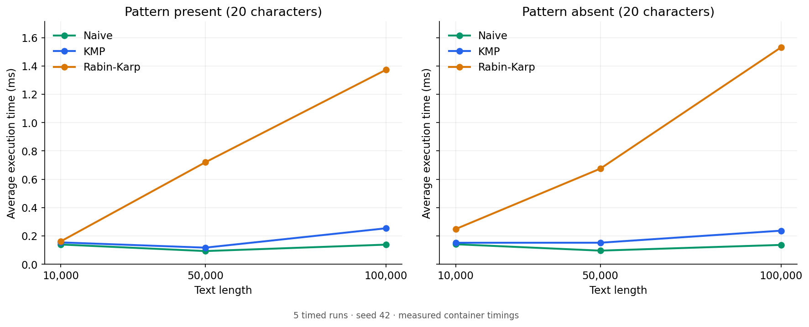
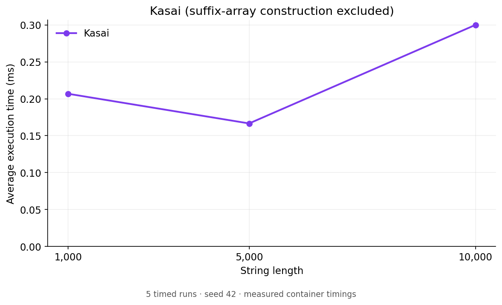

# Text Analysis Algorithms

Java implementations of LCS, Edit Distance, Naive matching, KMP, Rabin–Karp, and Kasai.

## Run

```sh
javac -d out src/algorithms/*.java src/*.java
java -cp out Main
```

Requires JDK 8+. Main calls `Tests.run()` then `Experiments.run()`, saving 27 rows to `experiments.csv` (replaced on rerun). Run tests alone with `java -cp out Tests`.

## Behavior and testing

Matchers use the original `naive()` / `search()` methods: first index, -1 if absent, 0 for an empty pattern. **This differs from the assignment's requirement to return all occurrences.** No searchAll method is included. Inputs must be non-null. Kasai requires a valid suffix array and compares each suffix with its sorted predecessor.

All **656 correctness checks passed** on OpenJDK 17. Tests cover LCS edge cases, edit operations, match positions, multiple/overlapping occurrences (first index only), absent/long/empty patterns, a hash collision, 200 random matching cases, and known LCP arrays.

## Experiments

Seed 42; uniform lowercase English alphabet a-z. Five warmups and five timed runs per case using System.nanoTime(); results report arithmetic means. Compared algorithms receive identical inputs. Input generation, validation, console/file output, and suffix-array construction are excluded; algorithm preprocessing is included.

| Task | Input lengths |
|---|---|
| LCS / Edit Distance | 100, 500, 1,000 per string |
| Matching | 10,000, 50,000, 100,000; patterns of length 20 |
| Kasai | 1,000, 5,000, 10,000 |

Present patterns come from the text's end; absent patterns are verified beforehand. The CSV's dp_cells counts n*m recurrence evaluations; NA means unmeasured. Random correctness tests use seed 67 and alphabet abc.

## Complexity

n = text length; m = pattern/second-string length. Matching bounds assume 1 ≤ m ≤ n.

| Algorithm | Time | Extra space |
|---|---|---|
| LCS / Edit Distance | Θ(nm), filling the DP table | Θ(nm) |
| Naive | Best Θ(m); worst O(nm) | O(1) |
| KMP | Best Θ(m); worst O(n+m), including LPS | O(m) |
| Rabin–Karp | Best Θ(m); expected O(n+m); worst O(nm) | O(1) |
| Kasai | Θ(n), excluding suffix-array construction | Θ(n) |

KMP reuses matched prefixes; Rabin–Karp verifies hash matches; Kasai reuses the previous LCP minus one.

## Results

Raw timings: [experiments.csv](experiments.csv). Plots show actual container measurements.





DP time grows strongly with size. Naive was fastest at 100,000 characters on these random inputs, where most comparisons fail early; hashing adds overhead. Some smaller inputs took longer than larger ones, consistent with JVM warmup and timing noise. These measurements do not establish worst-case complexity. KMP guarantees linear worst-case search; DP uses quadratic space for equal-length inputs.

Regenerate plots after rerunning Java:

```sh
python -m pip install matplotlib
python plot_results.py
```
